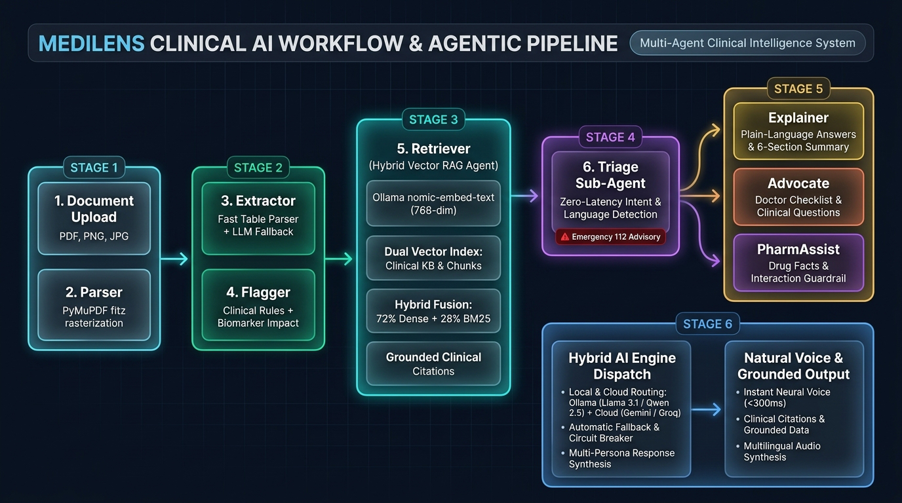

# MediLens — Clinical Report Intelligence, Hybrid Vector RAG & 7-Agent Health Assistant (v2.6)

[](https://react.dev/)
[](https://fastapi.tiangolo.com/)
[](core/rag.py)
[](https://tailwindcss.com/)
[](https://zustand-demo.pmnd.rs/)
[](https://ollama.ai/)
[](https://groq.com/)
[](LICENSE)

A privacy-first, voice-enabled clinical intelligence platform pairing a **Dual-Index Hybrid Vector RAG Engine** (`nomic-embed-text` 768-dim + Clinical BM25) with a **7-agent clinical swarm** and **universal auto-language mirroring**. MediLens translates laboratory panels, prescriptions, CT scans, X-rays, and surgical summaries into clear, citation-grounded patient education in whatever language the user writes or speaks.

> **Clinical Safety & Medical Disclaimer:** MediLens provides general medical educational information only. It **never diagnoses illnesses, prescribes treatments, or modifies medication dosages**. Any critical findings prompt immediate physician contact. Always consult a licensed healthcare professional.

---

## 🔄 End-to-End Hybrid Vector RAG, 7-Agent & Natural Voice Workflow



```
                            ┌──────────────────────────────────────────────┐
                            │   Patient / Doctor Upload (PDF, PNG, JPG)    │
                            │   Blood Panels · CT · X-Ray · Prescriptions  │
                            └──────────────────────┬───────────────────────┘
                                                   │
                                                   ▼
                                        [1. DOCUMENT PARSER]
                                         (core/parser.py)
                               PyMuPDF (fitz) digital text extraction
                               or raw image bytes for scanned vision
                                                   │
                                                   ▼
                                      [2. EXTRACTOR SUB-AGENT]
                                         (agents/extractor.py)
                             Sub-10ms deterministic lab table & Rx parser
                             with lean LLM/vision fallback for free-text
                                                   │
                                                   ▼
                                      [3. FLAGGER RULES ENGINE]
                                          (core/flagger.py)
                             Evaluates 40+ biomarkers (reference_ranges.json)
                             Flags Normal/High/Low/Critical + What It Is & Impact
                                                   │
                                                   ▼
                            ┌──────────────────────────────────────────────┐
                            │   [4. RETRIEVER SUB-AGENT — HYBRID RAG]      │
                            │      (agents/retriever.py · core/rag.py)     │
                            │ • Local Ollama nomic-embed-text (768-dim)    │
                            │ • Dual Vector Index:                         │
                            │   A) Clinical KB (24 Evidence Guides, .npz)  │
                            │   B) Background Report Chunks (480c window)  │
                            │ • Hybrid Fusion: 72% Cosine + 28% BM25       │
                            └──────────────────────┬───────────────────────┘
                                                   │  (Grounded Evidence + Citations)
                                                   ▼
                                       [5. TRIAGE SUB-AGENT]
                                         (agents/router.py)
                             Zero-latency emergency 112 safety detection,
                             intent routing & universal auto-language detection
                                                   │
                ┌──────────────────────────────────┴──────────────────────────────────┐
                │         RAG-GROUNDED SPECIALIZED SUB-AGENT TASK FAN-OUT             │
                ▼                                     ▼                               ▼
       [6. EXPLAINER AGENT]                 [7. ADVOCATE AGENT]            [8. PHARMASSIST AGENT]
      (agents/explainer.py)                (agents/doctor_prep.py)        (agents/medicine_info.py)
  • Mirrors ANY input language         • Guideline-backed doctor Qs       • Instant 26-drug lookup + batch
  • Cited RAG source badges in chat    • What-to-bring visit checklist    • Drug-drug interaction RAG
  • 6-Section Detailed Bullet Summary  • One-page consultation document   • Zero dose-change guardrail
                │                                     │                               │
                └──────────────────────────────────┬──┴───────────────────────────────┘
                                                   │
                                                   ▼
                                    [9. HYBRID AI ENGINE DISPATCH]
                                             (core/llm.py)
                   ┌───────────────────────────────┴───────────────────────────────┐
                   ▼                                                               ▼
       [PRIMARY CLOUD AI: GEMINI]                                     [ULTRA-FAST FALLBACK: GROQ]
  • Google Gemini 3.5 Flash (Vision & Reasoning)                 • Groq Cloud openai/gpt-oss-20b (~50ms LPU)
  • Automatic Failover to Gemini 3.5 Flash-Lite
                   │                                                               │
                   └───────────────────────────────┬───────────────────────────────┘
                                                   ▼
                                      [OFFLINE PRIVACY FALLBACK]
                                      • Meta Llama 3.1 8B (Local Ollama)
                                      (Automatic 60s Circuit Breaker)
                                                   │
                                                   ▼
                                    [10. NATURAL VOICE ENGINE]
                              (frontend/src/utils/voiceEngine.js · backend.py)
  • True hardware sample-rate PCM WAV capture + fast 1.25s silence VAD auto-submit
  • Confidence-aware Dual STT: Browser Web Speech API + Groq Whisper (99+ languages) / Google STT
  • Instant Full-Text Neural TTS: Browser Natural Neural Voices -> Groq/gTTS fallback + Instant Mute/Reset
  • Automatic voice cache clearing between conversations (POST /api/voice/clear-cache)
```

---

## 🧠 Hybrid Vector RAG Architecture (`Retriever` Engine)

MediLens implements a **privacy-first, local-first Dual-Index Hybrid Vector RAG pipeline** ([`core/rag.py`](core/rag.py), [`agents/retriever.py`](agents/retriever.py)) so every clinical explanation, bullet summary, medication audit, and doctor consultation question is grounded in both curated medical references and the full uploaded document:

1. **Local Neural Embeddings (`nomic-embed-text`):**
   - Uses local Ollama **`nomic-embed-text`** (`768`-dimensional L2-normalized dense vectors) by default so patient data stays on your hardware.
   - Automatic cloud fallback (`text-embedding-004`) if Ollama is offline, plus a zero-failure **Clinical BM25 Lexical** fallback.
2. **Dual Vector Index:**
   - **Collection A — Curated Clinical Knowledge Base ([`data/clinical_knowledge_base.json`](data/clinical_knowledge_base.json)):** 24 evidence-aligned references covering biomarkers (ADA, KDIGO, AHA/ACC, ASH, ATA), CT/X-Ray/surgical recovery guidelines (ACR, SAGES), pharmacology, and drug-drug interactions. Persisted on disk in `data/vector_store/kb_vectors.npz` via SHA-256 hash caching for `<15ms` startup.
   - **Collection B — Dynamic Session Report Index:** Every uploaded report's full untruncated text + structured results/prescriptions are chunked (`480`-char window, `90`-char overlap) and embedded in a non-blocking background thread so the dashboard loads in ~5 seconds while full RAG search becomes ready immediately.
3. **Hybrid Fusion Scoring (`72% Dense Cosine + 28% Clinical BM25`):**
   - Dense cosine similarity captures conceptual phrasing (*"blood fat"* → Triglycerides/LDL), while Clinical BM25 guarantees exact precision on clinical acronyms and drug names (`HbA1c`, `eGFR`, `Anti-TPO`, `NT-proBNP`, `Spironolactone`).
4. **Transparent Citations & API Endpoints:**
   - Every `/api/chat` response returns grounded `sources` (title, clinical source, relevance %) rendered as **RAG Grounded Sources** badges in the chat UI.
   - Diagnostic & search endpoints: `GET /api/rag/status` and `POST /api/rag/search`.

---

## 🤖 The 7 Named Sub-Agents (MediLens Swarm)

| Single Name | Full Role | Source File | Core Responsibilities & Capabilities |
| :--- | :--- | :--- | :--- |
| **`Extractor`** | Document Parser & Extractor Agent | [`agents/extractor.py`](agents/extractor.py) | Parses structured digital lab PDFs deterministically in `<10ms` (zero numeric hallucination), with lean LLM/vision fallback for unstructured CT/X-ray/surgical notes and scanned images. Preserves full raw text for RAG indexing. |
| **`Flagger`** | Clinical Reference Range Engine | [`core/flagger.py`](core/flagger.py) | Deterministic Python rules engine auditing 40+ biomarkers against [`data/reference_ranges.json`](data/reference_ranges.json) with strict word-boundary matching. Flags `NORMAL`, `HIGH`, `LOW`, or `CRITICAL` and provides concise **What It Is** & **Impact** guidance. |
| **`Retriever`** | Hybrid Vector RAG & Knowledge Agent | [`agents/retriever.py`](agents/retriever.py) | Embeds the Clinical Knowledge Base and uploaded report chunks via `nomic-embed-text` (768-dim). Executes Hybrid Dense Cosine + BM25 search to supply grounded guidelines, drug interactions, and verifiablez citations. |
| **`Triage`** | Intent, Safety & Auto-Language Agent | [`agents/router.py`](agents/router.py) | Zero-latency conversation gatekeeper. Detects acute emergency symptoms across languages (triggering Emergency 112 advisories), routes intent (`explain`, `doctor_prep`, `medicine`), and automatically detects ANY user input language. |
| **`Explainer`** | Plain-Language Explainer Agent | [`agents/explainer.py`](agents/explainer.py) | Delivers calm, RAG-grounded answers mirroring whatever language the user writes or speaks in. Generates dashboard overviews and powers the **Detailed Summary Popup** (6-section bullet breakdown). |
| **`Advocate`** | Doctor Visit Coach & Prep Agent | [`agents/doctor_prep.py`](agents/doctor_prep.py) | Combines flagged parameters with RAG clinical guidelines to formulate 5–7 prioritized physician questions, an appointment checklist, and a downloadable `.txt` consultation summary. |
| **`PharmAssist`** | Prescription & Pharmacology Agent | [`agents/medicine_info.py`](agents/medicine_info.py) | Instant 26-medication lookup + single batched RAG-grounded LLM call for unknown drugs. Explains purpose, side effects, and timing while strictly enforcing **zero dose changes, substitutions, or discontinuations**. |

---

## 🛠️ Complete Lean Technical Stack (Zero Unused Libraries)

All unused legacy dependencies (such as `gradio`, `pillow`, and unused TypeScript `@types/*` packages) have been audited and removed. Every listed package is actively used in production:

### Backend Python Packages ([`requirements.txt`](requirements.txt) — 10 Core Libraries)
| Package | Layer | Active Usage |
| :--- | :--- | :--- |
| **`fastapi`** | REST API Gateway | Asynchronous REST endpoints (`/api/analyze`, `/api/chat`, `/api/detailed-summary`, `/api/rag/*`, `/api/speak`, `/api/transcribe`, `/api/voice/clear-cache`) |
| **`uvicorn[standard]`** | ASGI Server | High-performance local ASGI server (`port 8000`) |
| **`pydantic`** | Schema Validation | Request/response models and structured report schemas ([`core/schemas.py`](core/schemas.py)) |
| **`python-multipart`** | File & Audio Uploads | `UploadFile` and `Form` handling for PDFs, images, and recorded PCM WAV audio |
| **`python-dotenv`** | Configuration | Loads local/cloud model settings and API keys from `.env` |
| **`requests`** | HTTP Client | Connects to local Ollama (`127.0.0.1:11434`), Google Gemini, and Groq APIs with proxy-bypass & circuit breaker |
| **`numpy`** | Hybrid Vector RAG | L2-normalized dense cosine vector similarity and compressed `.npz` disk vector caching ([`core/rag.py`](core/rag.py)) |
| **`pymupdf` (`fitz`)** | Document Parser | High-speed digital PDF text extraction ([`core/parser.py`](core/parser.py)) |
| **`SpeechRecognition`** | Server STT Fallback | Google speech recognition fallback when Groq Whisper / Web Speech API is unavailable |
| **`gTTS`** | Server TTS Fallback | Full-text multilingual speech synthesis fallback across 20+ auto-detected languages |

### Frontend JavaScript Packages ([`frontend/package.json`](frontend/package.json) — 7 Runtime + 5 Build Tools)
| Package | Layer | Active Usage |
| :--- | :--- | :--- |
| **`react` & `react-dom` (`v18`)** | UI Framework | Interactive clinical dashboard, chat assistant, doctor prep, and prescriptions views |
| **`zustand` (`v5`)** | State Management | Global store for reports, longitudinal comparison history, RAG citations, model selection, and audio mute state |
| **`framer-motion` (`v11`)** | Animations | Smooth view transitions, modal springs, and animated bioluminescent wave UI |
| **`lucide-react`** | Iconography | Clinical, alert, voice, and navigation icons |
| **`react-dropzone`** | File Upload | Drag-and-drop PDF & image upload modal ([`FileUpload.jsx`](frontend/src/components/FileUpload.jsx)) |
| **`react-hot-toast`** | Notifications | Non-intrusive upload, voice transcription, and status toast alerts |
| **`vite` + `@vitejs/plugin-react`** | Build & Dev Server | Sub-second HMR dev server (`port 3000`) with `/api` proxy and production bundling |
| **`tailwindcss` + `postcss` + `autoprefixer`** | Styling | Custom clinical dark glassmorphism palette and responsive layout |
| **Native Web Audio & Web Speech APIs** | Browser Voice | True hardware sample-rate PCM WAV capture, `1.25s` VAD auto-submit, live interim STT, and instant browser Neural TTS (`voiceEngine.js`) |

### AI Model Runtime (4-Model Hybrid Ensemble)
| Model | Runtime | Role |
| :--- | :--- | :--- |
| **Meta Llama 3.1 (`8B`)** | Local Ollama (`127.0.0.1:11434`) | **Default model** — 100% private offline inference with `15m` warm keep-alive |
| **Alibaba Qwen 3.8** | Local Ollama (`127.0.0.1:11434`) | High-reasoning local model for complex multi-organ reports |
| **Nomic Embed Text** | Local Ollama (`127.0.0.1:11434`) | 768-dim local neural embeddings for Hybrid Vector RAG |
| **Google Gemini 2.5 Flash** | Cloud API (optional) | Fast multimodal cloud inference and scanned-image vision extraction |
| **Groq Llama 3.3 70B & Whisper v3** | Cloud API (optional) | Low-latency cloud LLM + 99-language Whisper speech transcription |

---

## 🚀 Quickstart Guide

### 1. Prerequisites
- **Python:** `3.10+` (virtual environment recommended)
- **Node.js:** `18.0+` & `npm`
- **Ollama (Default local runtime for LLM + RAG embeddings):** [ollama.ai](https://ollama.ai)
  ```bash
  ollama pull llama3.1:8b
  ollama pull nomic-embed-text
  ```

### 2. Install Dependencies
```bash
# Backend
pip install -r requirements.txt

# Frontend
cd frontend && npm install
```

### 3. Configure Environment Variables
Edit [`.env`](.env) in the project root:
```env
# Local Ollama Service (Default — 100% Private LLMs + RAG Embeddings)
OLLAMA_BASE_URL=http://127.0.0.1:11434
OLLAMA_LLAMA_MODEL=llama3.1:8b
OLLAMA_QWEN_MODEL=qwen3.8:latest
OLLAMA_EMBED_MODEL=nomic-embed-text

# Default AI Model (llama3.1 | qwen3.8 | gemini | groq)
DEFAULT_MODEL=llama3.1

# Optional Cloud API Keys
GEMINI_API_KEY=your_google_ai_studio_key_here
GROQ_API_KEY=your_groq_api_key_here
GROQ_MODEL=llama-3.3-70b-versatile
```

### 4. Launch Development Servers

**PowerShell (One-Click):**
```powershell
.\run_dev.ps1
```

**Windows Batch:**
```cmd
run_dev.bat
```

Or run manually in two terminals:
```bash
# Terminal 1 — FastAPI Backend (Port 8000)
.\venv\Scripts\python.exe -m uvicorn api_server:app --reload --port 8000

# Terminal 2 — React Frontend (Port 3000)
cd frontend && npm run dev
```

Visit **`http://localhost:3000`** in your browser.

---

## 📂 Project Directory Structure

```
medilens/
├── api_server.py                 # FastAPI REST Gateway (/api/analyze, /api/chat, /api/rag/*, /api/voice/*)
├── backend.py                    # 7-Agent + Hybrid Vector RAG orchestrator & voice pipeline
├── run_dev.ps1                   # One-click PowerShell developer launcher
├── run_dev.bat                   # One-click Windows CMD batch launcher
├── requirements.txt              # Lean 10-package Python production dependencies
├── workflow_architecture.png     # Visual Hybrid RAG + 7-Agent + Natural Voice workflow diagram
│
├── agents/                       # Specialized Sub-Agents (The 7-Agent MediLens Swarm)
│   ├── extractor.py              # 'Extractor' (Sub-10ms table parser + lean LLM/vision fallback)
│   ├── retriever.py              # 'Retriever' (Hybrid Vector RAG & Citation Agent)
│   ├── router.py                 # 'Triage' (Zero-latency intent, emergency 112 & auto-language detection)
│   ├── explainer.py              # 'Explainer' (Auto-language RAG explanations & 6-section bullet summary)
│   ├── doctor_prep.py            # 'Advocate' (Guideline-grounded doctor questions & visit checklist)
│   └── medicine_info.py          # 'PharmAssist' (26-drug instant lookup + batched RAG pharmacology)
│
├── core/                         # Core Engines & Vector Store
│   ├── rag.py                    # Hybrid Vector RAG Engine (nomic-embed-text + BM25 + .npz cache)
│   ├── llm.py                    # Cascade AI Dispatch (Gemini 3.5 -> Groq gpt-oss-20b -> Llama 3.1)
│   ├── flagger.py                # 'Flagger' (40+ biomarker rules + ICMR & MedlinePlus guides)
│   ├── medical_apis.py           # Verified Authorities Client (MedlinePlus, RxNorm, openFDA, PubMed, ICMR, CDSCO)
│   ├── parser.py                 # PyMuPDF digital parser & raw image encoder
│   └── schemas.py                # Pydantic structured schemas
│
├── data/                         # Clinical Knowledge & Persistent Vector Cache
│   ├── clinical_knowledge_base.json  # 24 Curated Clinical & Pharmacology RAG Documents
│   ├── reference_ranges.json     # 40+ Clinical Reference Intervals with What It Is & Impact
│   └── vector_store/             # Disk-cached SHA-256 nomic-embed-text vectors (.npz)
│
├── frontend/                     # React 18 + Vite Frontend Application
│   ├── package.json              # Lean React + Vite + Tailwind packages
│   ├── vite.config.js            # Vite config with backend proxy (/api -> :8000)
│   ├── tailwind.config.js        # Tailwind glassmorphism color palette
│   └── src/
│       ├── App.jsx               # Main application layout & global header
│       ├── index.css             # Flowing silk wave keyframes & glass styling
│       ├── api/client.js         # Frontend fetch client connecting to FastAPI
│       ├── hooks/useStore.js     # Zustand global store, RAG citations & audio state
│       ├── utils/voiceEngine.js  # Instant Neural Voice Engine, sentence queue & cache reset
│       └── components/
│           ├── Sidebar.jsx       # Left navigation with animated bioluminescent waves
│           ├── ModelSelector.jsx # Live 4-model switcher (default: Llama 3.1 Local)
│           ├── ReportView.jsx    # Clinical dashboard, What-It-Is/Impact banner, trend needles & KPI rings
│           ├── DetailedSummaryModal.jsx # Plain-language 6-section bullet popup with full-text Speak
│           ├── ChatPanel.jsx     # Voice chat, clickable Speak/Stop pill & RAG Source badges
│           ├── DoctorPrep.jsx    # Doctor consultation questions & text download
│           ├── MedicinesPanel.jsx# Prescribed medication intelligence cards
│           └── FileUpload.jsx    # Drag-and-drop modal for PDF/image reports
│
└── test_reports/                 # 8 Benchmark Hospital-Grade Test Reports
    ├── 01_easy_annual_wellness_cbc.pdf
    ├── 02_easy_lipid_thyroid_screening.pdf
    ├── 03_intermediate_metabolic_liver_panel.pdf
    ├── 04_intermediate_autoimmune_thyroid_anemia.pdf
    ├── 05_hard_cardiorenal_electrolyte_crisis.pdf
    ├── 06_hard_complex_hematology_rheum_sepsis.pdf
    ├── 07_special_ct_scan_and_chest_xray_report.pdf
    ├── 08_special_surgery_operative_discharge_report.pdf
    └── README.md                 # Index of all 8 benchmark test scenarios
```

---

## 🧪 Comprehensive Benchmark Reports (`test_reports/`)

| Difficulty Tier | Report File | Clinical Scenario | Key Highlights |
| :--- | :--- | :--- | :--- |
| **Easy** | `01_easy_annual_wellness_cbc.pdf` | Routine Wellness CBC (28F) | Normal CBC & glucose; mild Vitamin D & low Ferritin with 2 supplements. |
| **Easy** | `02_easy_lipid_thyroid_screening.pdf` | Preventive Cardiac & Thyroid (36M) | Normal TSH/Free T4; borderline dyslipidemia (Chol 228, LDL 152) with Rosuvastatin. |
| **Intermediate** | `03_intermediate_metabolic_liver_panel.pdf` | T2 Diabetes + Fatty Liver (52M) | Uncontrolled glucose (`HbA1c 8.4%`), elevated ALT/AST/GGT, microalbuminuria (`uACR 48`). |
| **Intermediate** | `04_intermediate_autoimmune_thyroid_anemia.pdf` | Hashimoto's + Macrocytic Anemia (41F) | Elevated TSH (`14.8`), Anti-TPO (`412`), low Hb (`9.6`) with high MCV (`106.4 fL`) and low B12. |
| **Extremely Hard** | `05_hard_cardiorenal_electrolyte_crisis.pdf` | Cardiorenal Crisis + Hyperkalemia (68M) | **Critical:** Potassium `6.3 mmol/L`, eGFR `16`, pH `7.29`, NT-proBNP `4,850`, high-risk drug interaction. |
| **Extremely Hard** | `06_hard_complex_hematology_rheum_sepsis.pdf` | Severe Pancytopenia + HLH/Sepsis (59F) | **Critical:** WBC `2.1`, Platelets `48`, Ferritin `6,420 ng/mL`, DIC coagulopathy, high-titer ANA `1:640`. |
| **Special** | `07_special_ct_scan_and_chest_xray_report.pdf` | Contrast CT Abdomen + Chest X-Ray (47M) | Acute appendicitis (`11.4 mm` appendix, `6.5 mm` appendicolith), incidental renal stone, normal X-Ray. |
| **Special** | `08_special_surgery_operative_discharge_report.pdf` | Lap Cholecystectomy + Discharge (55F) | Operative notes (`18 mm` stone, `CBD 5.4 mm`), benign pathology, Day-2 labs & discharge meds. |

---

## 🛡️ Clinical Safety & Guardrails
1. **No Unsupervised Diagnoses:** MediLens explains what biomarkers measure and their potential clinical impact using grounded references, without claiming definitive diagnoses.
2. **No Treatment Alterations:** Strictly refuses requests to change dosages, substitute drugs, or stop prescribed medications.
3. **Emergency Routing:** Detects urgent cardiac, respiratory, or neurological red-flag symptoms in any language and escalates immediately with Emergency `112 / 911` guidance.
4. **Offline Privacy First:** When configured to run locally with Ollama (`llama3.1:8b` + `nomic-embed-text`), both LLM inference and RAG vector embeddings remain 100% on your local machine without sending data to external clouds.

---

## ⚙️ Model Configuration & Custom API Keys (`.env`)

MediLens makes it effortless for any user or developer to plug in their own API keys and choose their preferred AI model via a single configuration file ([`.env`](.env) or [`.env.example`](.env.example)):

```bash
# Copy template to active configuration
cp .env.example .env
```

### Configurable Parameters in `.env`

```env
# 1. PRIMARY AI ENGINE: Google Gemini (High Speed & Multimodal Vision)
# Get a free key: https://aistudio.google.com/
GEMINI_API_KEY=your_gemini_api_key_here
GEMINI_MODEL=gemini-3.5-flash

# 2. FIRST FALLBACK: Groq Cloud (Ultra-Fast ~50ms LPU Inference)
# Get a free key: https://console.groq.com/
GROQ_API_KEY=your_groq_api_key_here
GROQ_MODEL=openai/gpt-oss-20b

# 3. SECOND FALLBACK / OFFLINE PRIVACY ENGINE: Meta Llama 3.1
OLLAMA_BASE_URL=http://localhost:11434
OLLAMA_LLAMA_MODEL=llama3.1:8b
OLLAMA_EMBED_MODEL=nomic-embed-text

# 4. ACTIVE DEFAULT MODEL
# Select 'gemini', 'groq', or 'llama3.1'
DEFAULT_MODEL=gemini
```

### How to Install & Run Meta Llama 3.1 as Part of the Fallback

To enable local fallback or 100% offline private processing:

1. **Install Ollama**:
   - Download the installer for your OS from **[https://ollama.com/download](https://ollama.com/download)** (Windows, macOS, or Linux).
   - Complete installation and launch Ollama. It will run in the background at `http://localhost:11434`.

2. **Pull the Required Models**:
   Open a terminal and run:
   ```bash
   # Pull Meta Llama 3.1 8B for clinical reasoning
   ollama pull llama3.1

   # Pull nomic-embed-text for local 768-dim RAG vector embeddings
   ollama pull nomic-embed-text
   ```

3. **Verify Installation**:
   ```bash
   ollama list
   ```
   You should see `llama3.1:latest` (or `llama3.1:8b`) and `nomic-embed-text:latest` listed.

4. **Automatic Cascade Execution**:
   - When `DEFAULT_MODEL=gemini` is set in `.env`, MediLens uses Gemini 3.5 Flash for primary reasoning.
   - If Gemini is ever offline or rate-limited, MediLens automatically switches to **Groq (`openai/gpt-oss-20b`)** in under `50ms`.
   - If internet connectivity is interrupted or cloud APIs are exhausted, MediLens seamlessly cascades to **local Meta Llama 3.1** running on your local machine with zero data leakage.
